# Manual Técnico de la Práctica 1 (Grupal) – Redes de Computadoras 2

---

### INTRODUCCIÓN
La presente práctica tiene como finalidad


## Configuración de Máquinas Virtuales

Para la creación de las máquinas virtuales utilicé KVM (Kernel-based Virtual Machine) junto con la herramienta gráfica Virt-Manager (Gestor de máquinas virtuales).

KVM es una tecnología de virtualización que viene integrada en Linux. Básicamente, convierte el sistema operativo en un hipervisor, lo que permite crear y ejecutar máquinas virtuales como si fueran computadoras independientes dentro de mi propio equipo. Es decir, cada máquina virtual tiene su propio sistema operativo, memoria, almacenamiento y red, aunque realmente todo corre dentro de mi computadora principal.

<br>

### Paso 1: Creación de la máquina virtual desde Virt-Manager

<center>

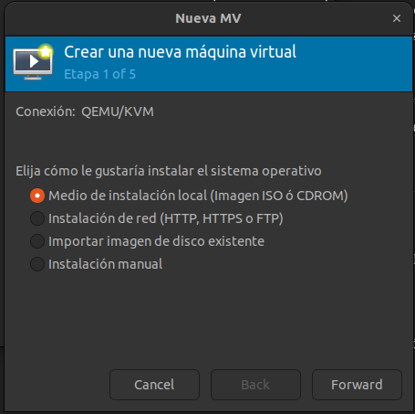

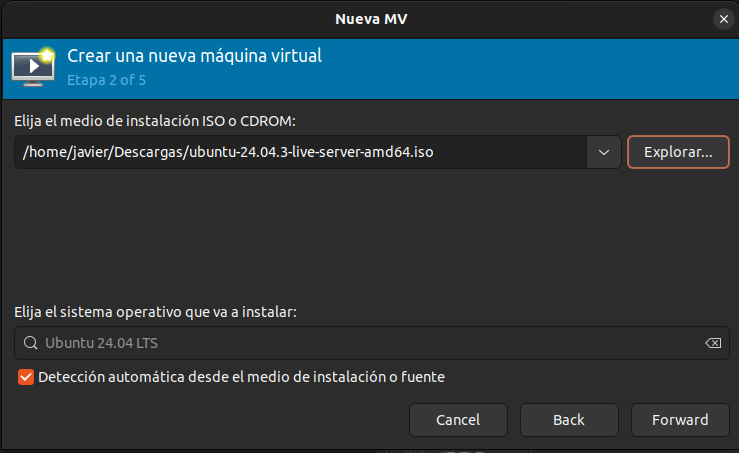

</center>

Para iniciar con la configuración del entorno, realicé la creación de las máquinas virtuales utilizando la herramienta Virt-Manager sobre QEMU/KVM.

Primero abrí el Gestor de máquinas virtuales y seleccioné la opción “Crear una nueva máquina virtual”. En esta primera etapa elegí la opción:

Medio de instalación local (Imagen ISO o CDROM)

Seleccioné esta opción porque ya había descargado previamente la imagen ISO de Ubuntu 24.04, la cual utilicé para instalar el sistema operativo dentro de cada máquina virtual.

En el siguiente paso, cargué la ISO ubicada en:

`/home/javier/Descargas/ubuntu-24.04.3-live-server-amd64.iso`

El sistema detectó automáticamente que se trataba de Ubuntu 24.04 LTS, por lo que no fue necesario configurar manualmente el tipo de sistema operativo.

Este proceso lo repetí para las tres máquinas virtuales que utilicé en el proyecto.


<br>

### Paso 2: Asignación de memoria, CPU y almacenamiento

<center>

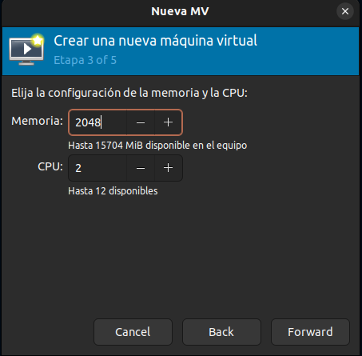

</center>

En el siguiente paso configuré los recursos que tendría cada máquina virtual. Aquí asigné la cantidad de memoria RAM y el número de procesadores (CPU) que utilizaría cada una.

Para cada máquina virtual configuré lo siguiente:
- Memoria (RAM): 2048 MiB (2 GB)
- CPU: 2 núcleos

Decidí asignar 2 GB de RAM porque es una cantidad suficiente para que Ubuntu Server funcione de manera estable junto con los contenedores que se ejecutarán posteriormente. Además, asigné 2 procesadores virtuales para mejorar el rendimiento al momento de ejecutar las APIs y realizar las pruebas de comunicación entre servicios.

Esta configuración me permitió mantener un equilibrio entre rendimiento y uso de recursos del equipo host, ya que estaba ejecutando tres máquinas virtuales al mismo tiempo.

<center>

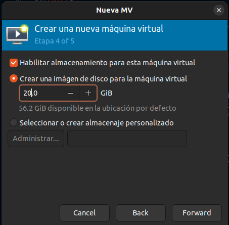

</center>

Después de configurar la memoria RAM y los procesadores, procedí a configurar el almacenamiento de cada máquina virtual.

En esta sección habilité la opción:
`Crear una imagen de disco para la máquina virtual`

Y asigné: `20.0 GiB de almacenamiento`

Decidí asignar 20 GB de disco porque es un espacio suficiente para instalar Ubuntu Server, instalar las herramientas necesarias (Containerd, Docker, Zot, Go, etc.) y además almacenar imágenes de contenedores sin que el sistema se quede sin espacio.

<br>

### Paso 3: Configuración final y nombre de la máquina virtual

<center>

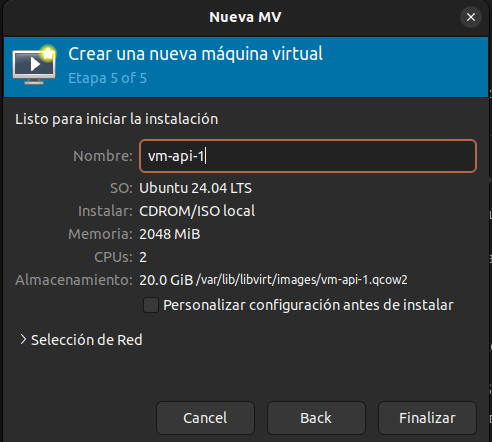

</center>

En el último paso antes de iniciar la instalación, realicé la configuración final de la máquina virtual.

Aquí asigné el nombre de la máquina, en este caso:

vm-api-1

El sistema ya mostraba un resumen con toda la configuración que había definido previamente:

- Sistema operativo: Ubuntu 24.04 LTS
- Instalación desde: CDROM/ISO local
- Memoria: 2048 MiB
- CPU: 2
- Almacenamiento: 20.0 GiB


Finalmente, presioné Finalizar, lo que inició automáticamente el proceso de instalación de Ubuntu dentro de la máquina virtual.

Este mismo procedimiento lo repetí para las otras dos máquinas virtuales, cambiando únicamente el nombre correspondiente, manteniendo la misma configuración de recursos.

<br>

### Paso 4: Instalación de Ubuntu Server dentro de la máquina virtual

Después de dar clic en “Finalizar”, la máquina virtual inició automáticamente con la ISO de Ubuntu y comenzó el proceso de instalación del sistema operativo. A continuación explico los pasos más relevantes.

#### Selección de idioma

<center>

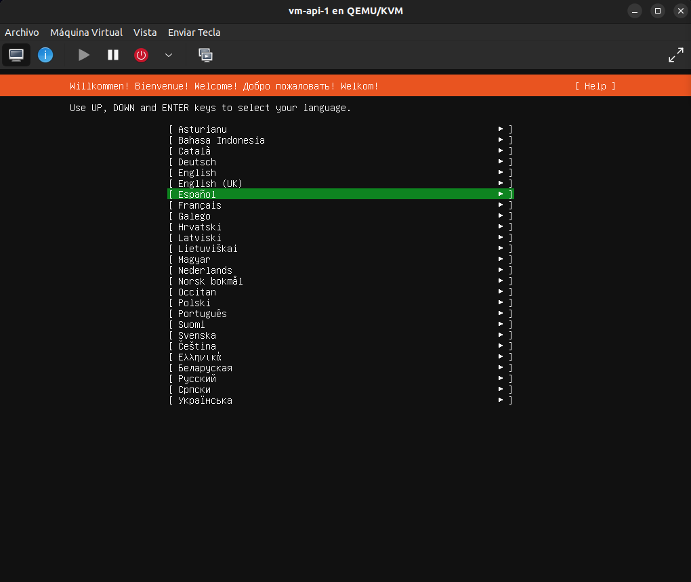

</center>


En esta pantalla seleccioné el idioma del sistema.
Elegí la opción:

`Español`

Esto lo hice para que todo el proceso de instalación y configuración fuera más claro y fácil de entender. Una vez seleccionado el idioma, presioné Enter para continuar.

#### Tipo de instalación

<center>

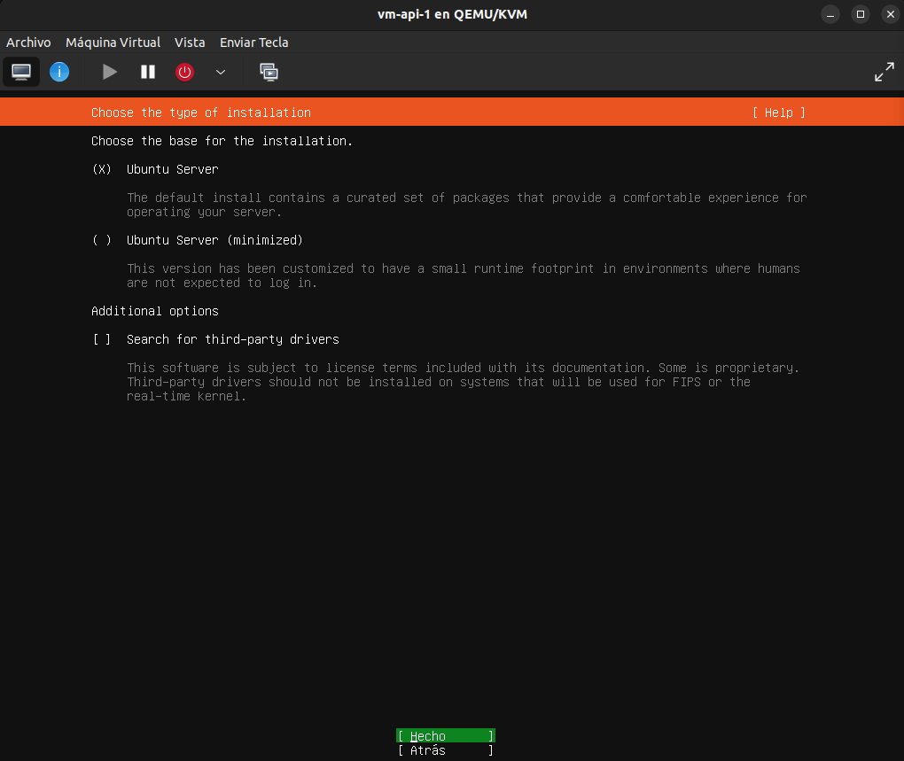

</center>


En esta pantalla el sistema me pidió elegir el tipo de instalación.
Seleccioné:

`Ubuntu Server`

No elegí la opción “minimized” porque necesitaba un entorno completo de servidor que me permitiera instalar posteriormente herramientas como Containerd, Docker y Zot sin limitaciones.

Luego presioné Hecho para continuar.

#### Configuración del mirror de Ubuntu

<center>

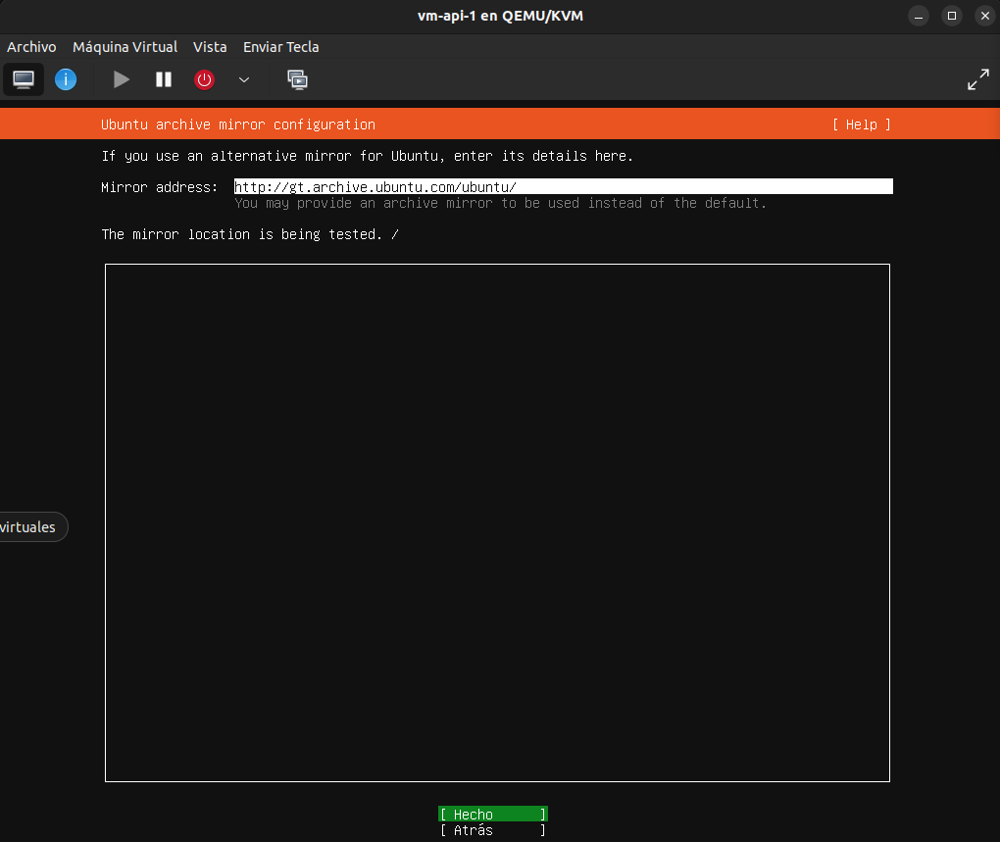

</center>


Aquí el instalador mostró la configuración del mirror (servidor desde donde se descargan los paquetes).

Dejé la configuración por defecto:

`http://gt.archive.ubuntu.com/ubuntu/`


No realicé ningún cambio, ya que el mirror detectado automáticamente era funcional. El sistema realizó una verificación automática y luego continué con la instalación.

#### Configuración de perfil y usuario

<center>

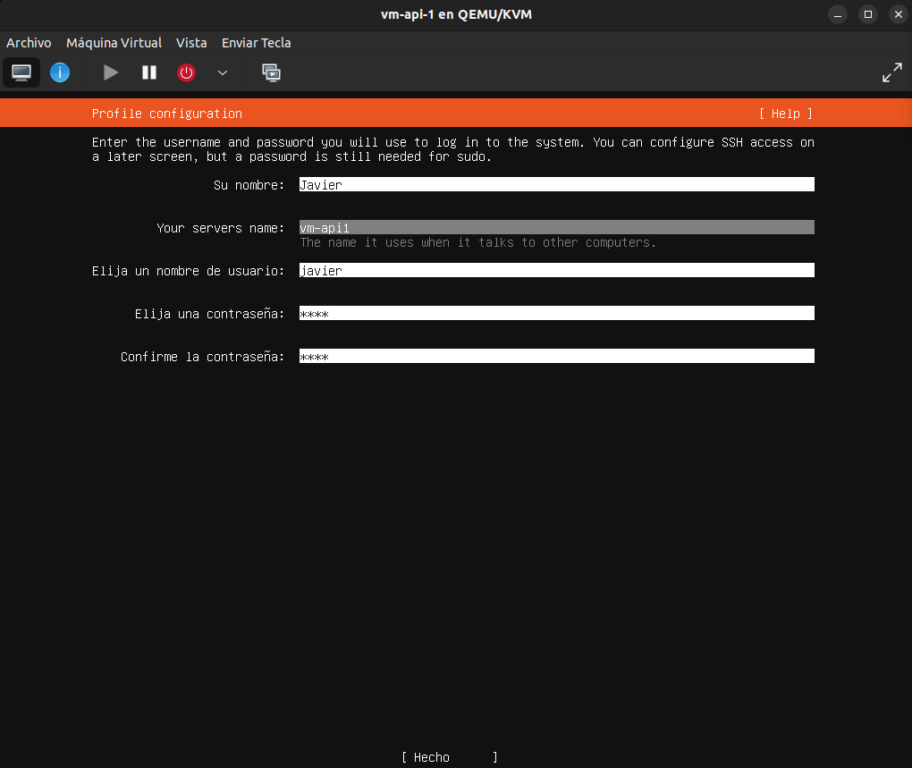

</center>


En esta pantalla configuré los datos del usuario principal del sistema.

Ingresé:

- Nombre: Javier
- Nombre del servidor: vm-api1
- Usuario: javier
- Contraseña: (configurada durante la instalación)

Aquí definí el usuario con el que posteriormente accedería al sistema y ejecutaría comandos con privilegios de administrador (sudo).

Este paso es importante porque establece las credenciales principales del servidor.

#### Configuración de SSH

<center>

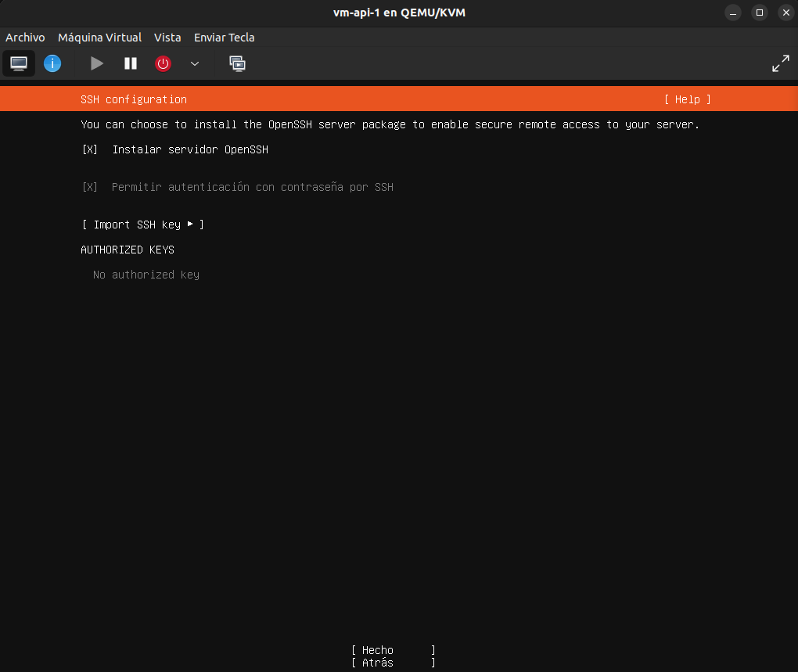

</center>


En esta parte seleccioné la opción:

- Instalar servidor OpenSSH
- Permitir autenticación con contraseña por SSH

Activé el servidor SSH porque necesitaba poder conectarme remotamente a la máquina virtual desde el equipo host usando la terminal. Esto facilita mucho la administración del servidor sin depender únicamente de la interfaz gráfica de Virt-Manager.

Luego presioné Hecho para continuar.

<br>

## Desarrollo de APIs en Go

### API1 – Implementación y explicación del código 

En esta sección realicé el desarrollo de la API1 en Go.

#### Paquetes importados

```go
import (
	"encoding/json"
	"fmt"
	"net/http"
	"os"
	"time"
)
 ```

Aquí importé las librerías necesarias para que la API funcione:

- `encoding/json`: la utilicé para convertir (encodear) mis structs a JSON y poder responder al cliente con el formato que pide el proyecto.

- `fmt`: la usé para imprimir mensajes en consola (por ejemplo, cuando el servidor inicia o si ocurre un error).

- `net/http`: es la base para crear un servidor web en Go. Con esto definí endpoints y levanté el servidor en un puerto.

- `os`: la usé para leer variables de entorno como CARNET, API2_HEALTH_URL y API3_HEALTH_URL.

- `time`: la usé para generar el timestamp en UTC, justo como lo pide el endpoint /health.

<br>


#### Estructuras (structs) para responder en JSON

```go
type HealthResponse struct {
	Status    string `json:"status"`
	Message   string `json:"message"`
	Timestamp string `json:"timestamp"`
	VM        string `json:"VM"`
	Carnet    string `json:"carnet"`
}
 ```

Este struct (HealthResponse) representa la forma exacta del JSON que mi API devuelve cuando alguien llama a:

`GET /health`


En Go, cuando yo hago un struct y luego lo convierto a JSON, cada campo del struct se vuelve una propiedad del JSON.
Los “tags” como `json:"status"` sirven para controlar el nombre exacto que va a aparecer en el JSON (por ejemplo, `Status` se vuelve `status`).
- `Status` y `Message`: son campos obligatorios según el enunciado.
- `Timestamp`: lo guardé como string para enviarlo ya formateado.
- `VM`: lo incluyo para indicar en qué VM está corriendo esta API (esto es parte del formato requerido).
- `Carnet`: debe ir en la respuesta y también en las rutas de llamadas.


```go
type CallResponse struct {
	APIName    string `json:"apiname"`
	Message    string `json:"message"`
	Connection bool   `json:"connection"`
	Carnet     string `json:"carnet"`
}
 ```

Este struct (`CallResponse`) es el JSON que devuelve la API cuando se hacen llamadas como:

- `/api1/#CARNET/call-api2`
- `/api1/#CARNET/call-api3`

En este caso:
- `APIName`: es el nombre de la API a la que se intentó contactar (API2 o API3).
- `Message`: es el texto que pide el proyecto (con “is working” o con “ERROR”).
- `Connection`: es un booleano que indica si la conexión fue exitosa.
- `Carnet`: se incluye para cumplir con el requisito del proyecto.

<br>

#### Inicio del main y variables de entorno

```go
miCarnet := os.Getenv("CARNET")
if miCarnet == "" {
	miCarnet = "202102140"
}
 ```

Aquí obtuve el carnet desde una variable de entorno llamada CARNET.
Esto es útil porque cuando la API corre dentro de un contenedor, yo puedo pasarle el carnet sin modificar el código (por ejemplo, desde Dockerfile o docker-compose).

El `if miCarnet == ""` es una validación: si no existe la variable, uso un valor por defecto. Eso evita que la API falle por no tener configurado el entorno.

```go
api2URL := os.Getenv("API2_HEALTH_URL")
if api2URL == "" {
	api2URL = "http://vm-api-1:8082/health"
}

api3URL := os.Getenv("API3_HEALTH_URL")
if api3URL == "" {
	api3URL = "http://vm-api-2:8083/health"
}
 ```

Aquí guardé en variables las URLs del endpoint /health de las otras APIs.

- Si API2_HEALTH_URL no está definida, uso una URL por defecto.
- Si API3_HEALTH_URL no está definida, uso otra URL por defecto.

Esto lo hice porque en un entorno distribuido (varias VMs), esas direcciones pueden cambiar. Con variables de entorno, solo cambio la configuración y no el código.

<br>

#### Inicio del main y variables de entorno

```go
http.HandleFunc("/health", func(w http.ResponseWriter, r *http.Request) {
	if r.Method != http.MethodGet {
		http.Error(w, "Method not allowed", http.StatusMethodNotAllowed)
		return
	}
```

Aquí registré un endpoint con `http.HandleFunc`.
Esto significa: “cuando alguien entre a `/health`, ejecutá esta función”.

- `w` (ResponseWriter): es lo que uso para responderle al cliente.
- `r` (Request): es la petición que llega (incluye método, headers, etc).

Luego validé el método. Si no es GET, devuelvo un error HTTP 405.
Con esto me aseguro de que el endpoint se use como el proyecto lo pide (GET /health).

<br>

#### Construcción de la respuesta JSON 
```go
res := HealthResponse{
	Status:    "UP",
	Message:   "API1 is Ready",
	Timestamp: time.Now().UTC().Format(time.RFC3339),
	VM:        "VM1",
	Carnet:    miCarnet,
}
```

Aquí construí un objeto (una instancia) del struct HealthResponse.

En otras palabras: res es una variable que contiene todos los campos que luego se van a convertir a JSON.

- `Status: "UP"`
Lo puse fijo como "UP" porque el proyecto indica que cuando la API está funcionando, debe responder con status UP. Este campo es el que otras APIs revisan para decidir si la API está operativa.

- `Message: "API1 is Ready"`
Es el mensaje que el enunciado solicita para /health. Sirve como confirmación humana de que la API levantó bien.

- `Timestamp: time.Now().UTC().Format(time.RFC3339)`

    Aquí generé la fecha/hora actual:

    - `time.Now()` obtiene el tiempo actual.

    - `.UTC()` lo convierte a UTC (para estandarizar).

    - `.Format(time.RFC3339)` lo convierte a un formato ISO estándar tipo:
    2026-02-19T18:37:51Z
    Esto es importante porque así se puede auditar cuándo respondió el servicio.

- `VM: "VM1"`
Lo dejé fijo porque esta API corre en la VM1. Esto lo pide el proyecto como parte del JSON.

- `Carnet: miCarnet`
Aquí uso el carnet obtenido por variable de entorno (o el default). Esto garantiza que el carnet aparezca en todas las respuestas, como lo exige el enunciado.

<br>


#### Construcción de la respuesta JSON 
```go
w.Header().Set("Content-Type", "application/json")
_ = json.NewEncoder(w).Encode(res)
})
```
- Con Content-Type indico que la respuesta es JSON.
- json.NewEncoder(w).Encode(res) convierte el struct res en JSON y lo escribe directamente en la respuesta HTTP.

El guion bajo `_ =` lo usé para ignorar el error de Encode, porque en este caso no quería detener la ejecución si algo menor fallaba, aunque en un entorno más estricto podría manejar el error.


<br>

```go
http.HandleFunc("/api1/"+miCarnet+"/call-api2", func(w http.ResponseWriter, r *http.Request) {
	if r.Method != http.MethodGet {
		http.Error(w, "Method not allowed", http.StatusMethodNotAllowed)
		return
	}

	callAPI(w, "API2", "VM1", api2URL, miCarnet)
})
```

Aquí creé el endpoint que el proyecto exige para API1:
`GET /api1/#CARNET/call-api2`

- La ruta incluye el carnet concatenando strings:
`"/api1/" + miCarnet + "/call-api2"`
Eso hace que el endpoint sea exactamente el requerido.

- Validé que el método sea GET, igual que en /health.

- Luego llamé a callAPI(...) para no repetir código.
Le pasé:

    - "API2": nombre de la API objetivo

    - "VM1": la VM donde está esa API (según tu arquitectura)

    - api2URL: URL al /health de API2

    - miCarnet: carnet para incluirlo en la respuesta


<br>

#### Endpoint para llamar a API3


```go
http.HandleFunc("/api1/"+miCarnet+"/call-api3", func(w http.ResponseWriter, r *http.Request) {
	if r.Method != http.MethodGet {
		http.Error(w, "Method not allowed", http.StatusMethodNotAllowed)
		return
	}

	callAPI(w, "API3", "VM2", api3URL, miCarnet)
})
```
Este endpoint es igual al anterior, solo que apunta a API3 y a su VM correspondiente.

<br>

### Levantar el servidor

```go
fmt.Println("API1 iniciada en el puerto 8081...")
if err := http.ListenAndServe(":8081", nil); err != nil {
	fmt.Println("Error iniciando servidor:", err)
}
```

- `ListenAndServe(":8081", nil)` inicia el servidor HTTP en el puerto 8081.
- El nil significa que se usará el “router” por defecto de `net/http` (donde registré mis endpoints con `HandleFunc`).

Si ocurre un error (por ejemplo, el puerto está ocupado), lo imprimo en consola.

<br>


### Función auxiliar callAPI (llamadas internas)

```go
func callAPI(w http.ResponseWriter, targetName string, targetVM string, url string, carnet string) {

	w.Header().Set("Content-Type", "application/json")

	client := &http.Client{Timeout: 3 * time.Second}
	resp, err := client.Get(url)
```

Esta función la hice para centralizar la lógica de “probar si otra API está viva”.

- Recibe `targetName`, `targetVM`, `url`, `carnet`, para que sea reutilizable.

- Crea un `http.Client` con timeout, para no quedarse esperando si la otra API está caída.

- Hace un `GET` a la URL (que debe ser el `/health` de la otra API).

<br>

**Manejo de error o API caída**

```go
if err != nil || resp.StatusCode != http.StatusOK {

	_ = json.NewEncoder(w).Encode(CallResponse{
		APIName:    targetName,
		Message:    "ERROR: The " + targetName + " located on the " + targetVM + " is not working",
		Connection: false,
		Carnet:     carnet,
	})
	return
}
```

Aquí cubrí dos problemas:

- `err != nil`: significa que ni siquiera se pudo conectar (DNS, red, API apagada, etc).

- `resp.StatusCode != 200`: significa que respondió, pero con error (500, 404, etc).

En ambos casos respondo con un CallResponse donde:

- `Connection: false`

- `Message` comienza con `"ERROR:"` (tal como el ejemplo del enunciado)

- `APIName` y `Carnet` se incluyen siempre

Esto es importante porque demuestra que la API maneja fallos de red correctamente, como pide el proyecto.

<br>

**Respuesta exitosa**

```go
defer resp.Body.Close()

_ = json.NewEncoder(w).Encode(CallResponse{
	APIName:    targetName,
	Message:    "The " + targetName + " located on the " + targetVM + " is working",
	Connection: true,
	Carnet:     carnet,
})
```

- defer resp.Body.Close() cierra la respuesta HTTP cuando la función termine, para no dejar recursos abiertos.

- Luego devuelvo un JSON indicando éxito:

    - Connection: true

    - Mensaje "is working"

    - Con el carnet

Las tres APIs mantienen una estructura base común, variando únicamente el puerto, los endpoints específicos y las URLs de comunicación.

<br>

## Contenerización de las APIs con Docker

Para poder ejecutar mis APIs de forma aislada y portable, utilicé Docker como herramienta de contenerización. Esto me permitió empaquetar la aplicación junto con todas sus dependencias y ejecutarla de manera consistente en cualquier entorno.

#### ¿Qué es Docker?

Docker es una herramienta que permite crear y ejecutar aplicaciones dentro de contenedores.

Básicamente, Docker me permitió “empaquetar” mi API junto con todo lo que necesita para funcionar (Go, dependencias, configuraciones, etc.) y ejecutarla como si fuera una pequeña máquina independiente, pero mucho más ligera que una máquina virtual.

A diferencia de una VM, un contenedor no necesita un sistema operativo completo, sino que comparte el kernel del sistema host. Por eso es más rápido y consume menos recursos.

En este proyecto utilicé Docker principalmente para:
- Construir imágenes de mis APIs.
- Ejecutarlas como contenedores.
- Subirlas al registro privado (Zot).
- Ejecutarlas en diferentes máquinas virtuales.

<br> 

### ¿Qué es una Docker Image?

Una Docker Image es como una plantilla o fotografía de la aplicación.

En mi caso, la imagen contiene:

- El sistema base (por ejemplo - Alpine Linux).
- El binario compilado de la API en Go.
- Las configuraciones necesarias.
- El puerto que debe exponer.

La imagen no se ejecuta directamente, sino que sirve para crear contenedores.

<br> 

### ¿Qué es un Contenedor?

Un contenedor es una instancia en ejecución de una imagen.

Es decir:

- La imagen es la plantilla.
- El contenedor es la aplicación ya corriendo.

Cuando yo hago:

`docker run api1-202102140`


Estoy creando un contenedor basado en la imagen `api1-202102140`.

Ese contenedor ya ejecuta mi servidor en el puerto 8081 y queda listo para recibir peticiones HTTP.

En este proyecto cada API se ejecuta dentro de su propio contenedor, lo que permite:

- Aislamiento.
- Portabilidad.
- Fácil despliegue.
- Simulación de arquitectura real distribuida.

<br> 

### ¿Qué es un Dockerfile?

Un Dockerfile es un archivo de texto que contiene un conjunto de instrucciones declarativas utilizadas por Docker para construir una imagen de manera automatizada.

En términos técnicos, el Dockerfile define el proceso de creación de una imagen especificando:

- La imagen base desde la cual se parte.
- El entorno de trabajo dentro del contenedor.
- Los archivos que deben copiarse.
- Las dependencias que deben instalarse.
- Los comandos que deben ejecutarse durante la construcción.
- El puerto que utilizará la aplicación.
- El comando que se ejecutará cuando el contenedor inicie.

Cada instrucción dentro del Dockerfile se ejecuta en orden y genera una nueva capa dentro de la imagen. Estas capas permiten optimizar la construcción mediante mecanismos de caché, lo que hace que el proceso sea más eficiente en reconstrucciones posteriores.

<br> 

### Dockerfile de la API1

A continuación explico el Dockerfile que utilicé para construir la imagen de la API1.

```text
FROM golang:1.22-alpine AS builder
```


Aquí estoy usando una imagen oficial de Go versión 1.22 basada en Alpine Linux.

La palabra AS builder significa que estoy creando una etapa llamada "builder". Esto forma parte de un multi-stage build, que sirve para compilar la aplicación en una etapa y luego copiar solo el resultado final a una imagen más ligera.

Esto ayuda a que la imagen final sea más pequeña y más segura.

<br> 

```text
WORKDIR /app
```

Aquí establecí el directorio de trabajo dentro del contenedor como /app.

Todo lo que copie o ejecute después ocurrirá dentro de esa carpeta.

<br> 

```text
COPY go.mod ./
```


Aquí copié el archivo go.mod desde mi proyecto hacia el contenedor.

Este archivo contiene las dependencias del proyecto en Go.

<br> 

```text
RUN go mod download
```

Con este comando descargué todas las dependencias definidas en go.mod.

Esto es importante porque permite que el proyecto tenga todo lo necesario para compilar correctamente.

<br> 

```text
COPY main.go ./
```


Aquí copié el archivo principal de la API (main.go) al contenedor.

<br> 

```text
RUN go build -o api1 main.go
```


En esta línea compilé el programa Go dentro del contenedor.

go build compila el código.

-o api1 indica que el archivo ejecutable se llamará api1.

Aquí se genera el binario final que luego será copiado a la imagen final.

<br> 

Segunda etapa (imagen final más ligera)

```text
FROM alpine:latest
```


Aquí inicio una segunda etapa usando Alpine Linux puro.

Esta imagen es mucho más pequeña porque ya no necesito el compilador de Go, solo necesito ejecutar el binario.

<br> 

```text
WORKDIR /root/
```


Defino el directorio de trabajo en la imagen final.

<br> 

```text
COPY --from=builder /app/api1 .
```


Aquí copio únicamente el archivo compilado api1 desde la etapa anterior (builder) hacia esta imagen final.

Esto es lo que hace que la imagen sea ligera: no copio todo el entorno de Go, solo el ejecutable.

<br> 

```text
EXPOSE 8081
```


Aquí indico que el contenedor utilizará el puerto 8081.

Esto no abre el puerto automáticamente, pero sirve como documentación y referencia para cuando se ejecute el contenedor.

<br> 

```text
CMD ["./api1"]
```


Finalmente, esta línea indica qué comando se ejecutará cuando el contenedor inicie. En este caso, ejecuta el binario api1, que levanta el servidor HTTP en el puerto 8081.

<br>

Para los Dockerfiles de API2 y API3 se siguió exactamente la misma estructura utilizada en la API1, manteniendo el mismo enfoque de construcción en múltiples etapas (multi-stage build). La única diferencia radica en ajustes específicos como el nombre del ejecutable generado y el puerto expuesto

<br> 

## Configuración de Containerd y red interna (VM1 y VM2)

En esta etapa configuré VM1 y VM2 para que pudieran ejecutar contenedores usando Containerd y, al mismo tiempo, comunicarse correctamente entre sí y con el registro privado Zot (que está en VM3). La idea principal fue que ambas máquinas pudieran resolver nombres por hostname (sin depender únicamente de IPs) y que Containerd pudiera hacer pull de imágenes desde el registry usando vm3-zot:5000.

<br> 

### ¿Qué es Containerd?

Containerd es un runtime de contenedores. En pocas palabras, es el servicio que se encarga de descargar, almacenar y ejecutar contenedores en Linux.
En este proyecto lo utilicé porque el enunciado solicita específicamente que VM1 y VM2 trabajen con Containerd, mientras que VM3 trabaja con Docker para levantar Zot.

<br> 

### VM1 (vm1containerd) — Configuración realizada

#### Instalación de Containerd en VM1 

Para poder ejecutar contenedores en VM1, instalé Containerd, ya que estas máquinas no utilizan Docker sino directamente el runtime solicitado en el proyecto.

El comando utilizado fue:

```
sudo apt install -y containerd
```

- sudo: ejecuta el comando con privilegios de administrador.
- apt install: instala un paquete desde los repositorios oficiales de Ubuntu.
- -y: confirma automáticamente la instalación sin pedir validación manual.
- containerd: es el nombre del paquete que contiene el runtime de contenedores.

Al ejecutar este comando, el sistema descargó e instaló automáticamente:

- Containerd
- runc (que es el runtime que ejecuta los contenedores a bajo nivel)

<br> 

#### Verificación del servicio

Después de la instalación, verifiqué que el servicio estuviera activo:

```
sudo systemctl status containerd
```

- systemctl: permite administrar servicios en sistemas Linux con systemd.
- status: muestra el estado actual del servicio.
- containerd: nombre del servicio que se desea consultar.

El resultado mostró:

```
active (running)
```

Esto confirma que Containerd está funcionando correctamente.

<br> 


#### Verificación de red: IP y hostname

Primero verifiqué que la máquina tuviera el nombre correcto y una IP asignada.

```
hostname
hostname -I
```

`hostname`: me muestra el nombre actual del sistema (en mi caso `vm1containerd`).

`hostname -I`: me muestra la IP asignada a la máquina (por ejemplo `192.168.122.169`).
Esto es importante porque esa IP se usa para conectividad entre las VMs.

<br> 

#### Configuración del archivo /etc/hosts (resolución por nombres)

Luego configuré el archivo /etc/hosts para que VM1 pudiera resolver por nombre a las otras máquinas, sin necesidad de depender de DNS.

```
sudo nano /etc/hosts
```

Al final del archivo agregué estas entradas:

```
192.168.122.169 vm1containerd
192.168.122.217 vm2containerd
192.168.122.134 vm3-zot
```

Con esto logré que:

- vm2containerd apunte a la IP de VM2
- vm3-zot apunte a la IP de VM3 (registro Zot)
- vm1containerd se mantenga referenciada localmente

Esto es clave para el proyecto porque así puedo usar hostnames en vez de IPs en configuraciones y URLs internas.

<br> 

#### Verificación de conectividad (ping)

Después probé que VM1 realmente pudiera comunicarse con VM2 y VM3:

```
ping -c 1 vm3-zot
ping -c 1 vm2containerd
```

- `ping -c 1`: envía solo 1 paquete para validar conectividad rápida.
- Si responde, significa que la red está bien y el hostname está resolviendo correctamente.

<br> 

#### Generación de la configuración de Containerd

Como el directorio de configuración no existía, lo creé y generé el archivo config.toml por defecto:

```
sudo mkdir -p /etc/containerd
sudo containerd config default | sudo tee /etc/containerd/config.toml
```

- mkdir -p /etc/containerd: crea el directorio de configuración (si no existe).
- containerd config default: genera una configuración base completa.
- tee .../config.toml: guarda esa salida directamente en el archivo de configuración.

Esto es importante porque me permite modificar Containerd para trabajar con el registro privado (Zot).

<br> 

#### Configuración del mirror hacia el registro privado (Zot)

Luego edité el archivo de configuración para indicarle a Containerd que el registro privado está en vm3-zot:5000 y que se puede acceder por HTTP.

```
sudo nano /etc/containerd/config.toml
```

Dentro del archivo busqué la sección:

```
[plugins."io.containerd.grpc.v1.cri".registry.mirrors]
```

Y agregué:

```
[plugins."io.containerd.grpc.v1.cri".registry.mirrors."vm3-zot:5000"]
  endpoint = ["http://vm3-zot:5000"]
```

Esto sirve para que Containerd pueda hacer pull de imágenes desde Zot usando el hostname vm3-zot y sin depender de la IP directamente.

<br> 

#### Reinicio y verificación del servicio

Después reinicié el servicio para aplicar los cambios:

```
sudo systemctl restart containerd
sudo systemctl status containerd
```

- restart: aplica los cambios del config.toml.
- status: confirmé que el servicio quedara en active (running).

Con esto, VM1 quedó lista para trabajar con imágenes desde el registry.

<br> 

En VM2 realicé el mismo procedimiento general que en VM1, ya que también utiliza Containerd y debe conectarse al registro Zot.

<br> 

## Configuración de VM3 — Registro Privado con Zot

La máquina virtual VM3 (vm3-zot) fue destinada exclusivamente para funcionar como registro privado de imágenes, utilizando la herramienta Zot.

A diferencia de VM1 y VM2, en esta máquina no se ejecutan APIs ni Containerd. Su única función dentro de la arquitectura es almacenar y distribuir las imágenes de los contenedores.

<br> 

### ¿Qué es Zot?

Zot es un registro de contenedores ligero y compatible con el estándar OCI (Open Container Initiative).

En términos simples, Zot funciona como un “repositorio privado” donde puedo subir (push) y descargar (pull) imágenes de Docker o Containerd.

En este proyecto, Zot me permitió:

- Almacenar las imágenes de API1, API2 y API3.
- Permitir que VM1 y VM2 descargaran esas imágenes.
- Simular un entorno real de despliegue con un registro privado.

<br> 

### Instalación de Docker en VM3

Como Zot se ejecuta como contenedor, primero instalé Docker en VM3.

```
sudo apt update
sudo apt install -y docker.io
```

- apt update: actualiza la lista de paquetes disponibles en el sistema.
- apt install -y docker.io: instala Docker desde los repositorios oficiales de Ubuntu.
- -y: confirma automáticamente la instalación.

Después de instalarlo, activé y verifiqué el servicio:
```
sudo systemctl enable docker
sudo systemctl start docker
sudo systemctl status docker
```

- enable: configura Docker para que inicie automáticamente al arrancar la máquina.
- start: inicia el servicio en ese momento.
- status: permite verificar que el servicio esté en estado active (running).

Esto confirmó que Docker estaba funcionando correctamente en la VM3.

<br> 

### Ejecución de Zot como contenedor

Una vez Docker estuvo listo, procedí a levantar Zot como contenedor.

```
sudo docker run -d \
  -p 5000:5000 \
  --name zot-registry \
  ghcr.io/project-zot/zot-linux-amd64:latest
```

- docker run: crea y ejecuta un contenedor.
- -d: ejecuta el contenedor en segundo plano.
- -p 5000:5000: expone el puerto 5000 del contenedor hacia el puerto 5000 de la máquina.
- --name zot-registry: asigna un nombre al contenedor.
- ghcr.io/project-zot/zot-linux-amd64:latest: imagen oficial de Zot.

<br> 

Después verifiqué que el contenedor estuviera corriendo:

```
sudo docker ps
```
<br>

## Construcción y Publicación de Imágenes en Zot (VM3)

Una vez que el registro privado Zot estaba funcionando en VM3, procedí a construir las imágenes de las tres APIs y subirlas al registry.

<br>

### Construcción y Push de API1

Primero ingresé a la carpeta correspondiente:

```
cd API1
```

Luego construí la imagen:

```
sudo docker build -t api-202102140 .
```


- docker build: construye una imagen a partir del Dockerfile.
- -t: asigna un nombre (tag) a la imagen.
- .: indica que el contexto de construcción es la carpeta actual.

Después de esto, la imagen quedó almacenada localmente en VM3.

<br>

### Etiquetado para el Registry

Para poder subir la imagen al registry, la etiqueté con el formato requerido:

```
sudo docker tag api-202102140 localhost:5000/api1-202102140
```

- docker tag: crea una nueva referencia para la imagen.
- localhost:5000: indica que la imagen será subida al registry que corre en VM3.
- api1-202102140: nombre final dentro del registry.

<br>

### Subida al Registry (Push)

```
sudo docker push localhost:5000/api1-202102140
```

Este comando envió la imagen al registro privado que está escuchando en el puerto 5000.

<br>

### Construcción y Push de API2

Repetí el mismo procedimiento para API2.

```
cd ~/API2

sudo docker build -t api2-202102140 .

sudo docker tag api2-202102140 localhost:5000/api2-202102140

sudo docker push localhost:5000/api2-202102140
```

Aquí la diferencia principal fue:

- El nombre de la imagen (api2-202102140).
- El ejecutable interno generado en el Dockerfile (api2).
- El puerto expuesto (8082).
- El proceso fue exitoso y la imagen quedó almacenada en Zot.

<br>

### Construcción y Push de API3

Luego realicé exactamente el mismo procedimiento con API3:

```
cd ~/API3

sudo docker build -t api3-202102140 .

sudo docker tag api3-202102140 localhost:5000/api3-202102140

sudo docker push localhost:5000/api3-202102140
```

La diferencia en este caso fue:

- Nombre de imagen: api3-202102140
- Puerto expuesto: 8083

Al finalizar, las tres imágenes estaban subidas al registro privado.

<br>

### Verificación del Registry

Para confirmar que Zot almacenó correctamente las imágenes, ejecuté:

```
curl -s http://localhost:5000/v2/_catalog
echo
```

El resultado fue:

```
{"repositories":["api1-202102140","api2-202102140","api3-202102140"]}
```


<br>


## Despliegue de API1 y API2 en VM1 con Containerd

Una vez que las imágenes estaban almacenadas en el registry privado (Zot en VM3), procedí a descargarlas en VM1 utilizando Containerd.

### Descarga de imágenes (Pull)

Ejecuté los siguientes comandos:

```
sudo ctr images pull --plain-http vm3-zot:5000/api1-202102140:latest
sudo ctr images pull --plain-http vm3-zot:5000/api2-202102140:latest
```

- ctr images pull: descarga una imagen desde un registry.
- --plain-http: permite conexión sin HTTPS (ya que el registry está en red interna).
- vm3-zot:5000: indica el hostname y puerto del registry.
- api1-202102140 y api2-202102140: nombres de las imágenes almacenadas en Zot.

Después verifiqué que las imágenes estuvieran disponibles localmente:

```
sudo ctr images ls | grep 202102140
```

Con esto confirmé que VM1 ya tenía las imágenes descargadas y listas para ejecutarse.

<br>

### Levantar API1


Para ejecutar API1 utilicé:
```
sudo ctr run -d --net-host \
  --env CARNET=202102140 \
  --env API2_HEALTH_URL=http://localhost:8082/health \
  --env API3_HEALTH_URL=http://vm2containerd:8083/health \
  vm3-zot:5000/api1-202102140:latest api1
```

- ctr run: crea y ejecuta un contenedor.
- -d: lo ejecuta en segundo plano.
- --net-host: hace que el contenedor use la red del host (no crea red aislada).
- --env: define variables de entorno necesarias para la comunicación entre APIs.
- api1: es el nombre que asigné al contenedor en ejecución.

Con esto, API1 quedó ejecutándose en el puerto 8081 dentro de VM1.

<br>

### Levantar API2

Luego ejecuté API2:

```
sudo ctr run -d --net-host \
  --env CARNET=202102140 \
  --env API1_HEALTH_URL=http://localhost:8081/health \
  --env API3_HEALTH_URL=http://vm2containerd:8083/health \
  vm3-zot:5000/api2-202102140:latest api2
```

La lógica es la misma que API1:

- Se ejecuta en segundo plano.
- Usa la red del host.
- Se configuran las variables de entorno para comunicación interna.
- Se le asigna el nombre api2 al contenedor.

<br>

En VM2 realicé un procedimiento similar.

<br>

## PRUEBAS

### Health

#### VM1:
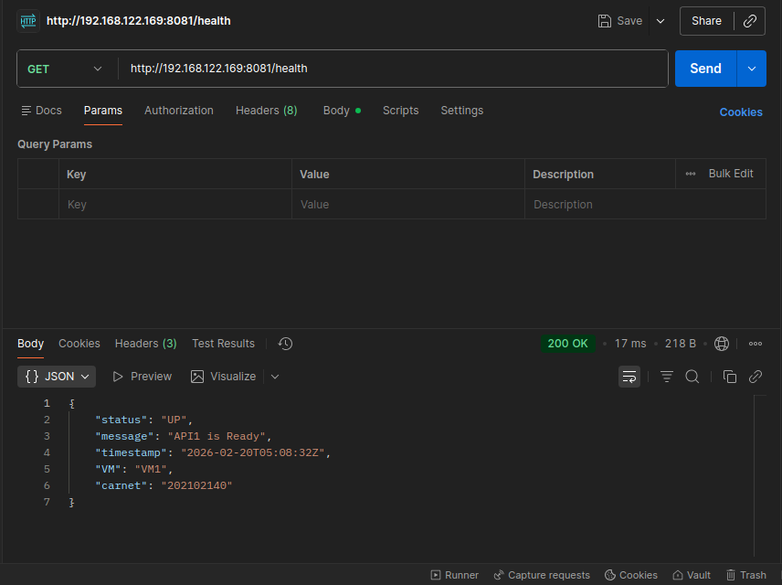
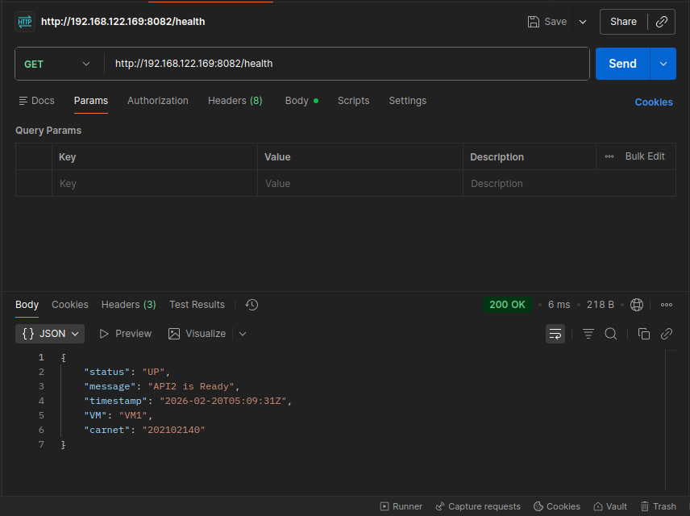

<br>

#### VM2:

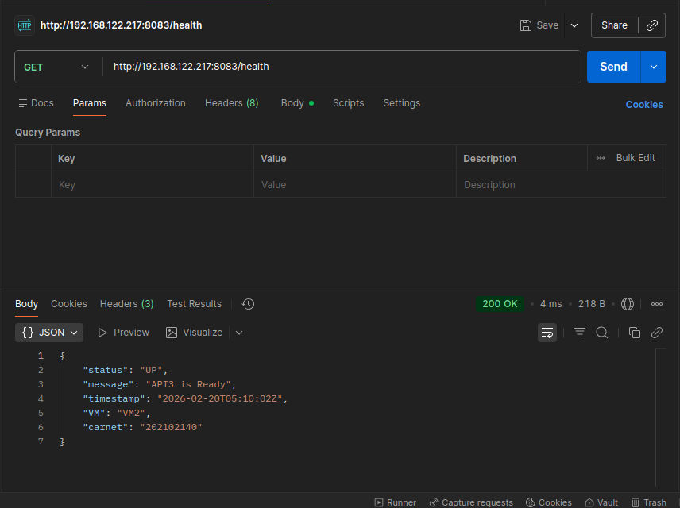

<br>

#### Llamadas cruzadas

API1 → API3:

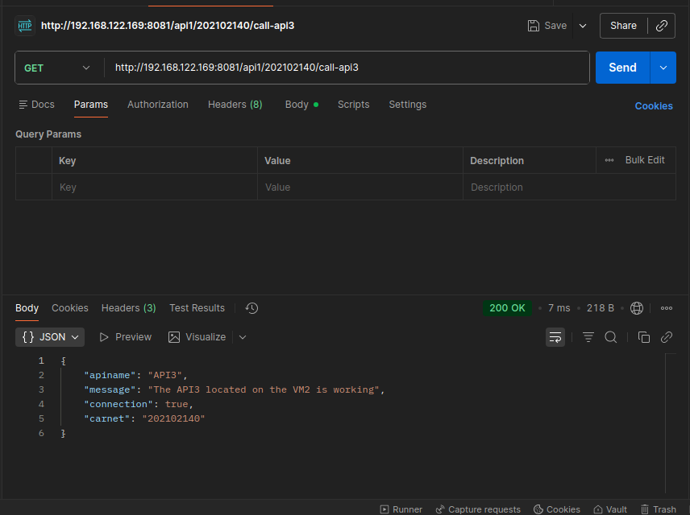

API3 → API2:

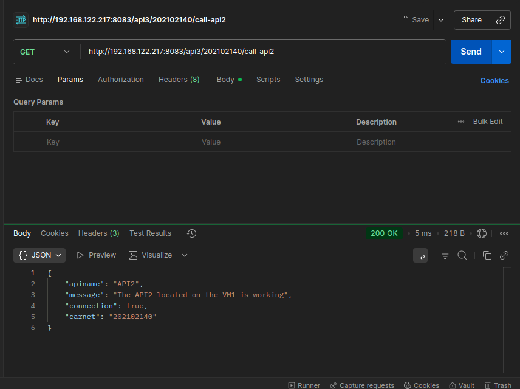


